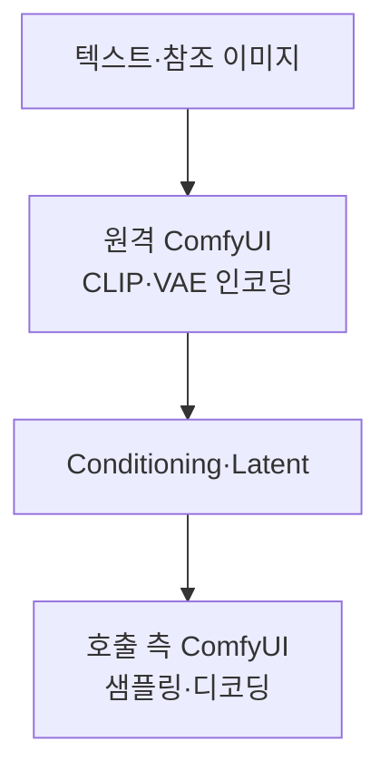

[English](README.md) · 한국어

# RemoteWorker

ComfyUI 런타임 간 conditioning 전달 및 원격 인코딩·프롬프트 생성·VAE 디코딩 커스텀 노드 모음.
원격 peer가 인코더·프롬프트 모델·선택적 VAE 디코딩을 수행하고, 호출 측은 conditioning·latent·텍스트를 수신해 샘플링 등 후속 워크플로 진행.

## 노드



| 노드 | 기능 / 출력 |
| --- | --- |
| Save Conditioning / Load Conditioning | CPU `.cond` 파일 저장 및 타 런타임 로드 (업로드·드래그 앤 드롭·붙여넣기 지원) |
| Remote Conditioning | 원격 CLIP 인코딩 실행 → `CONDITIONING` 반환 |
| Remote MiniMax H3 Reference Encode | 이미지·영상·오디오 참조 인코딩 → `CONDITIONING`, `LATENT` 반환 |
| Remote MiniMax H3 Image to Video | 텍스트 및 선택적 시작/끝 프레임 인코딩 → `CONDITIONING`, `LATENT` 반환 |
| Remote Prompt Enhancer | 원격 관리 프로필·선택적 미디어 참조 기반 프롬프트 생성 → `STRING` 반환 |
| Remote Qwen Image 2.1 | 원격 텍스트·참조 이미지·VAE 인코딩 → positive/negative conditioning, latent 반환 |
| Remote VAE Decode / Audio | peer 디코딩 → CPU IMAGE·AUDIO 무손실 반환 |
| Remote VAE Warmup | 최소 더미 디코딩 예약 → 완료 ticket 및 입력 passthrough 반환 |
| Remote VAE Selector | 연결된 원격 노드용 VAE 모델명 선택 |

- artifact 저장 노드 및 내부 Qwen worker 자동 등록.

## 설치

ComfyUI Python 환경 및 의존성 사용.

```sh
cd /path/to/ComfyUI/custom_nodes
git clone https://github.com/pollux-o4/RemoteWorker.git
```

- 설치 후 ComfyUI 재시작 필수.
- 호출 측과 peer 양쪽에 RemoteWorker 설치 필요.
- peer에는 어댑터 요구 모델 및 호환 노드 선행 설치 필요 (RemoteWorker 자동 다운로드 미제공).

## 사용법

### Conditioning 파일 전달

1. 생성 측: 인코더를 **Save Conditioning**에 연결.
2. 전달: 생성된 `.cond` 파일을 소비 측 `input/`으로 복사 또는 **Load Conditioning**에 업로드.
3. 소비 측: **Load Conditioning**을 후속 워크플로에 연결.

보안·호환성:
- 양측 텍스트 인코더 및 conditioning 소비 규약 일치 필수.
- `.cond`·`.latent`는 PyTorch 직렬화 사용: 신뢰하는 런타임 파일만 로드.

### 원격 어댑터 사용

1. peer 실행: 모델·노드가 설치된 ComfyUI 기동.
2. 호출 측 설정: 워크플로에 원격 어댑터 배치, `server_url`에 peer HTTP(S) origin 입력.
3. 목록 갱신: 모델·프로필 새로고침 후 옵션 선택 및 입력 연결.
4. 결과 연계: 반환된 conditioning, latent, text를 후속 노드에 연결.

보안·네트워크:
- 주소 형식: 경로·query·fragment·인증정보 없는 HTTP(S) origin 입력 (`http://127.0.0.1:8188`) · peer 주소 변경 후 모델·프로필 목록 새로고침 필수.
- 보안 경계: RemoteWorker는 ComfyUI에 추가 인증이나 암호화를 제공하지 않음 · 신뢰 네트워크 또는 별도 보호 터널 사용 필수.

## 문서

- [아키텍처와 공유 계약](docs/ARCHITECTURE.md)
- [로컬 기본값 설정](docs/configuration.md)

## 개발과 검증

- 브랜치 모델: `main` 통합 브랜치, `user` 검증 반영 브랜치 (모음 저장소는 `user` 추적).
- 테스트 실행: ComfyUI Python 환경 필요 (JS 계약 테스트는 Node.js 필요).

```sh
REMOTEWORKER_CONFIG="" python -m unittest discover -s tests -q
```

- Qwen V3 네이티브 스키마 검사 (`PYTHONPATH` ComfyUI 필요, 부재 시 자동 스킵):

```sh
REMOTEWORKER_CONFIG="" PYTHONPATH=/path/to/ComfyUI:. python -m unittest discover -s tests -p test_remote_qwen_image21.py -q
```

## 자동 준비

- 상태 확인: 사이드바 자동 준비 → 자동 준비 상태
- 비활성화: `REMOTEWORKER_AUTOPREPARE=0`
- 세부 정책: [자동 준비 계약](docs/contracts/preparation.md)

### 공유 파일로 영상 저장

양측 서버에 동일한 절대 경로 `REMOTEWORKER_SHARED_VAE_DIR` 설정 (GenRel 기본: `<GenRel>/shared/remote-vae`).

`샘플러 → 공유 VAE latent 저장 → 원격 VAE 영상 저장 · 공유 파일`

- H3 결합 latent 음성: `audio_vae_name`에 처리 서버의 오디오 VAE 모델명 지정
- 재시도: `request_id`에 이전 작업 ID 지정
- 세부 계약: [저장·완료·재시도 계약](docs/contracts/shared-video.md)
