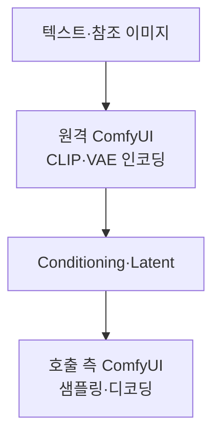

[English](README.md) · 한국어

# RemoteWorker

ComfyUI 런타임 사이에서 conditioning을 전달하고, 다른 ComfyUI 인스턴스에 인코딩이나 프롬프트 생성을 맡기는 커스텀 노드 모음입니다.

원격 런타임(peer)이 인코더나 프롬프트 모델을 실행합니다. 호출 측은 conditioning, latent 데이터 또는 텍스트를 받아 자신의 워크플로를 이어서 실행합니다. 샘플링과 최종 이미지·영상 디코딩은 호출 측에서 수행합니다.

## 노드



| 노드 | 기능 / 출력 |
| --- | --- |
| Save Conditioning / Load Conditioning | CPU `.cond` 파일을 저장하고 다른 런타임에서 읽습니다. 로드 시 업로드·드래그 앤 드롭·붙여넣기를 지원합니다. |
| Remote Conditioning | 원격 CLIP 인코딩을 실행하고 `CONDITIONING`을 반환합니다. |
| Remote MiniMax H3 Reference Encode | 이미지·영상·오디오 참조를 인코딩하고 `CONDITIONING`, `LATENT`를 반환합니다. |
| Remote MiniMax H3 Image to Video | 텍스트와 선택적 첫·마지막 프레임을 인코딩하고 `CONDITIONING`, `LATENT`를 반환합니다. |
| Remote Prompt Enhancer | 원격에서 관리하는 프로필과 선택적 이미지·영상 참조로 프롬프트를 생성하고 `STRING`을 반환합니다. |
| Remote Qwen Image 2.1 | 원격 텍스트·참조 이미지·VAE 인코딩을 실행하고 positive conditioning, negative conditioning, latent 데이터를 반환합니다. |
| Remote VAE Selector | 연결된 원격 노드에서 사용할 VAE 이름을 선택합니다. |

원격 워크플로에 사용하는 artifact 저장 노드와 내부 Qwen worker도 함께 등록합니다.

## 설치

설치한 ComfyUI의 Python 환경과 의존성을 사용합니다.

```sh
cd /path/to/ComfyUI/custom_nodes
git clone https://github.com/pollux-o4/RemoteWorker.git
```

설치 후 ComfyUI를 재시작합니다. 원격 실행에는 호출 측과 peer 양쪽에 RemoteWorker가 필요합니다. peer에는 선택한 어댑터가 요구하는 모델 파일과 호환 노드도 설치되어 있어야 합니다. RemoteWorker가 이를 내려받지는 않습니다.

## 사용법

### Conditioning 파일 전달

1. 생성 측 런타임에서 인코더를 **Save Conditioning**에 연결합니다.
2. 만들어진 `.cond` 파일을 소비 측 런타임의 `input/`으로 옮기거나 **Load Conditioning**에서 업로드합니다.
3. **Load Conditioning**을 소비 측 워크플로에 연결합니다.

양쪽의 텍스트 인코더와 conditioning 소비 규약이 호환되어야 합니다. `.cond`와 `.latent`는 PyTorch 직렬화를 사용하므로 신뢰하는 런타임의 파일만 읽으세요.

### 원격 어댑터 사용

1. 필요한 모델과 노드를 설치한 peer ComfyUI 인스턴스를 실행합니다.
2. 호출 측 워크플로에 원격 어댑터를 추가하고 `server_url`에 peer의 HTTP(S) origin을 입력합니다.
3. 모델·프로필 목록 새로고침을 지원하는 노드에서는 목록을 갱신하고, 필요한 옵션을 선택한 뒤 입력을 연결합니다.
4. 반환된 conditioning, latent 데이터 또는 텍스트를 호출 측의 후속 워크플로에 연결합니다.

주소는 `http://127.0.0.1:8188`처럼 경로·query·fragment·인증정보가 없는 origin으로 입력합니다. 실제 peer 주소에 맞게 설정하세요. peer 주소를 바꾼 뒤에는 모델·프로필 목록을 새로고침합니다.

RemoteWorker는 ComfyUI에 인증이나 암호화를 추가하지 않습니다. 신뢰하는 네트워크나 별도로 보호한 연결을 사용하세요.

## 문서


- [아키텍처와 공유 계약](docs/ARCHITECTURE.md)
- [로컬 기본값 설정](docs/configuration.md)

## 개발과 검증

`main`은 통합 브랜치이며 `user`에는 검증된 변경을 반영합니다. 모음 저장소는 `user`를 추적합니다.

ComfyUI Python 환경에서 테스트를 실행합니다. JavaScript 계약 테스트에는 Node.js가 필요합니다.

```sh
REMOTEWORKER_CONFIG="" python -m unittest discover -s tests -q
```

Qwen V3 네이티브 스키마 검사는 `PYTHONPATH`에 ComfyUI가 있어야 실행되며, 없으면 건너뜁니다.

```sh
REMOTEWORKER_CONFIG="" PYTHONPATH=/path/to/ComfyUI:. python -m unittest discover -s tests -p test_remote_qwen_image21.py -q
```
