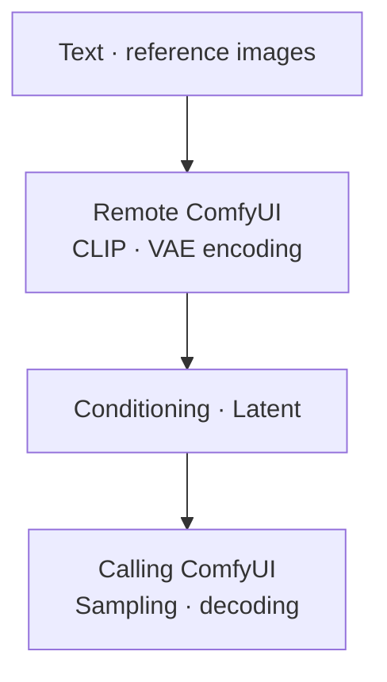

English · [한국어](README.ko.md)

# RemoteWorker

ComfyUI custom nodes for transferring conditioning between runtimes and delegating encoding or prompt generation to another ComfyUI instance.

The peer runs the encoder or prompt model. The calling runtime receives conditioning, latent data, or text and continues its own workflow. Sampling and final image/video decoding stay on the calling runtime.

## Nodes



| Node | Purpose / output |
| --- | --- |
| Save Conditioning / Load Conditioning | Save CPU `.cond` files and load them in another runtime. Upload, drag-and-drop, and paste are supported for loading. |
| Remote Conditioning | Run CLIP encoding on a peer and return `CONDITIONING`. |
| Remote MiniMax H3 Reference Encode | Encode image, video, and audio references; return `CONDITIONING` and `LATENT`. |
| Remote MiniMax H3 Image to Video | Encode text and optional first/last frames; return `CONDITIONING` and `LATENT`. |
| Remote Prompt Enhancer | Generate a prompt using a peer-managed profile and optional image/video references; return `STRING`. |
| Remote Qwen Image 2.1 | Run text, reference-image, and VAE encoding on a peer; return positive conditioning, negative conditioning, and latent data. |
| Remote VAE Selector | Select a VAE name for connected remote nodes. |

The package also registers artifact-saving nodes and an internal Qwen worker used by remote workflows.

## Installation

Use the Python environment and dependencies of your ComfyUI installation.

```sh
cd /path/to/ComfyUI/custom_nodes
git clone https://github.com/pollux-o4/RemoteWorker.git
```

Restart ComfyUI after installation. For remote execution, install RemoteWorker on both the calling runtime and the peer. The peer also needs the model files and compatible nodes required by the selected adapter; RemoteWorker does not download them.

## Usage

### Transfer conditioning files

1. Connect an encoder to **Save Conditioning** in the producing runtime.
2. Transfer the resulting `.cond` file to the consuming runtime's `input/` directory, or upload it through **Load Conditioning**.
3. Connect **Load Conditioning** to the consuming workflow.

Use compatible text encoders and conditioning consumers on both sides. `.cond` and `.latent` files use PyTorch serialization; load only files from trusted runtimes.

### Use a remote adapter

1. Start the peer ComfyUI instance with the required models and nodes installed.
2. Add a remote adapter to the calling workflow and set `server_url` to the peer's HTTP(S) origin.
3. Refresh the peer's model or profile list where available, select the required options, and connect inputs.
4. Connect the returned conditioning, latent data, or text to the rest of the calling workflow.

Use an origin such as `http://127.0.0.1:8188`, without a path, query, fragment, or embedded credentials. Set the address to match your peer. Refresh model/profile lists after changing the peer address.

RemoteWorker does not add authentication or encryption to ComfyUI. Use a trusted network or a separately secured connection.

## Documentation


- [Architecture and shared contracts](docs/ARCHITECTURE.md)
- [Local default overrides](docs/configuration.md)

## Development and verification

`main` is the integration branch; `user` contains validated changes. The collection repository tracks `user`.

Run tests in a ComfyUI Python environment. Node.js is required for JavaScript contract tests.

```sh
REMOTEWORKER_CONFIG="" python -m unittest discover -s tests -q
```

The native Qwen V3 schema test needs ComfyUI on `PYTHONPATH` and is otherwise skipped:

```sh
REMOTEWORKER_CONFIG="" PYTHONPATH=/path/to/ComfyUI:. python -m unittest discover -s tests -p test_remote_qwen_image21.py -q
```
