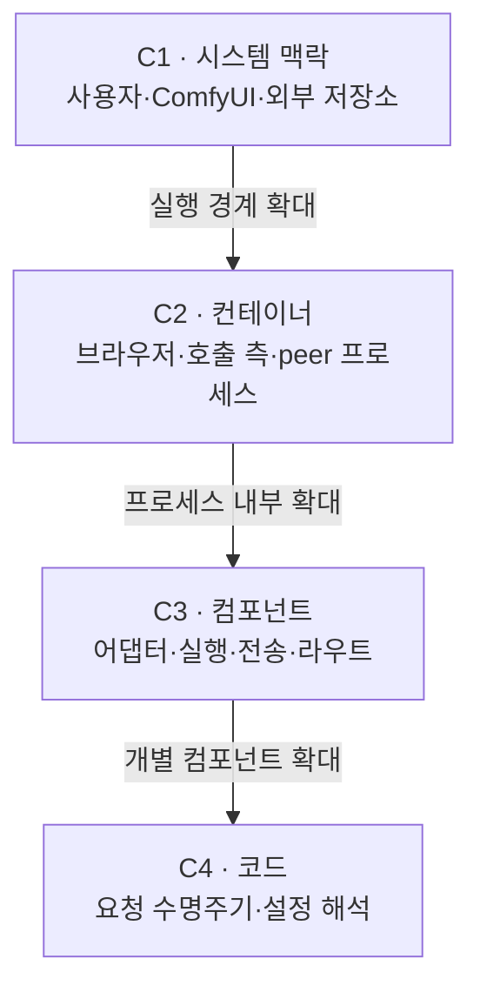

# RemoteWorker 아키텍처 맵



| 뷰 | 범위 |
| --- | --- |
| [C1 · 시스템 맥락](architecture/01-context.md) | 사용자, RemoteWorker, ComfyUI, 모델·결과 파일 저장소 |
| [C2 · 컨테이너](architecture/02-containers.md) | 브라우저, 호출 측 프로세스, peer 프로세스, 영속 데이터 |
| [C3 · 컴포넌트](architecture/03-components.md) | 브라우저 확장, 모델 어댑터, 실행·전송 계층, peer 라우트 |
| [C4 · 코드](architecture/04-code.md) | 요청 컨텍스트, HTTP 어댑터, artifact 계약, 설정 해석 |

## 소스 구조

```text
__init__.py                 ComfyUI 진입점
remoteworker/
├── registry.py             노드·라우트 등록
├── defaults.py             공개·외부 기본값
├── core/                   실행·전송·artifact·캐시
├── integration/            ComfyUI IO·조회·프로필 라우트
├── conditioning/           CLIP 입력·workflow
├── minimax/                참조 미디어·workflow·모델 어댑터
├── prompt/                 프롬프트 생성·프로필 저장
└── qwen/                   호출 어댑터·V3 worker
web/                        브라우저 확장
tests/                      계약·실행·브라우저 회귀검증
tools/                      격리 인스턴스 스모크 검사
```

## 변경 라우팅

| 경계 | 소유 코드 | 검증 |
| --- | --- | --- |
| 노드·라우트 등록 | [`remoteworker/registry.py`](../remoteworker/registry.py) | `tests/test_node_contracts.py` |
| 공개·로컬 기본값 | [`remoteworker/defaults.py`](../remoteworker/defaults.py) | `tests/test_node_contracts.py` |
| 호출 입력·peer capability 검증 | [`remoteworker/core/protocol.py`](../remoteworker/core/protocol.py) | `tests/test_node_contracts.py`, `tests/test_transport.py` |
| 제출·취소·임시 입력 | [`remoteworker/core/execution.py`](../remoteworker/core/execution.py) | `tests/test_transport.py`, `tests/test_conditioning.py` |
| HTTP·폴링·업로드·다운로드 | [`remoteworker/core/transport.py`](../remoteworker/core/transport.py) | `tests/test_transport.py` |
| artifact 식별·요청 경로 | [`remoteworker/core/artifacts.py`](../remoteworker/core/artifacts.py) | `tests/test_artifact_io.py` |
| conditioning 직렬화 | [`remoteworker/integration/artifact_io.py`](../remoteworker/integration/artifact_io.py) | `tests/test_artifact_io.py` |
| CLIP·grounded workflow | [`remoteworker/conditioning/workflow.py`](../remoteworker/conditioning/workflow.py) | `tests/test_conditioning.py` |
| MiniMax 참조 미디어·첫/마지막 프레임 | [`remoteworker/minimax/reference.py`](../remoteworker/minimax/reference.py), [`remoteworker/minimax/image_to_video.py`](../remoteworker/minimax/image_to_video.py) | 모델별 계약 테스트 |
| Qwen positive·negative·latent | [`remoteworker/qwen/service.py`](../remoteworker/qwen/service.py), [`remoteworker/qwen/worker.py`](../remoteworker/qwen/worker.py) | V3 네이티브 스키마·모델 계약 테스트 |
| 프로필 스키마·저장 | [`remoteworker/prompt/profiles.py`](../remoteworker/prompt/profiles.py) | `tests/test_remoteworker/prompt/service.py`, `tests/test_routes.py` |
| 브라우저 선택값·프로필 폼·소켓 | [`web/remote_choices.js`](../web/remote_choices.js), [`web/remote_profiles.js`](../web/remote_profiles.js), [`web/remote_profile_dialog.js`](../web/remote_profile_dialog.js), [`web/remote_sockets.js`](../web/remote_sockets.js) | `tests/test_web_choices.py`, `tests/test_web_sockets.py` |
