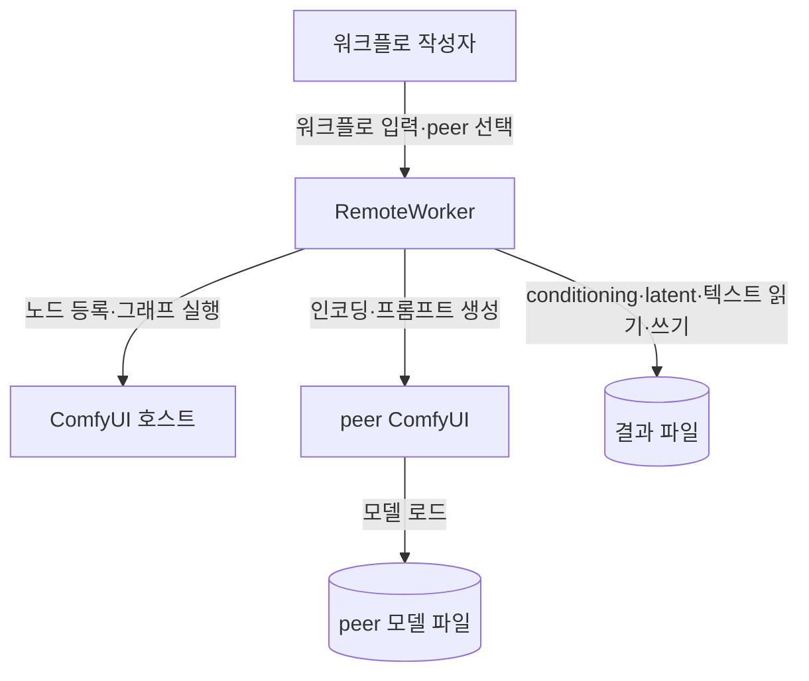

# C1 · 시스템 맥락

| 경계 | 계약 |
| --- | --- |
| 호출 측 → peer | ComfyUI HTTP API·선택한 모델명·요청별 미디어 |
| peer → 호출 측 | conditioning·latent 텐서·생성 텍스트 |
| 파일 전달 | 호환되는 생성·소비 측 사이의 `.cond` 전달 |
| 신뢰 범위 | 신뢰하는 peer·PyTorch 파일; 인증·TLS는 외부 연결 계층 |

## 파일·접속 계약

| 항목 | 제약 |
| --- | --- |
| `.cond`·`.latent` | PyTorch 직렬화; 신뢰하는 생성 런타임의 파일만 로드 |
| conditioning 호환 | 인코더 의미 체계·소비 노드·ComfyUI/PyTorch 조합; 파일 내부 호환성 메타데이터·자동 판별 없음 |
| `server_url` | HTTP(S) origin; 경로·query·fragment·인증정보 제외 |
