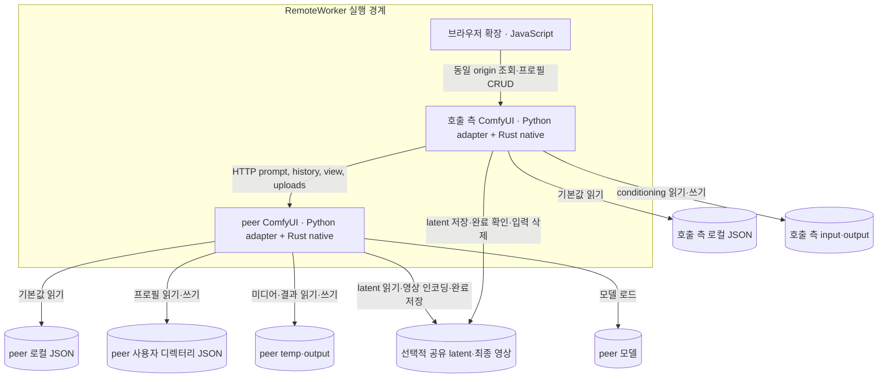

# C2 · 컨테이너

| 실행 단위 | 실행 위치 |
| --- | --- |
| 브라우저 확장 | ComfyUI 프런트엔드; Canvas·Nodes 2.0 |
| 호출 측 노드 패키지 | 호출 측 ComfyUI Python 프로세스 · Rust 확장 내장 |
| peer 노드 패키지 | 인코딩 측 ComfyUI Python 프로세스 · Rust 확장 내장 |
| 프로필 레지스트리 | peer ComfyUI 사용자 디렉터리 |
| 기본값 덮어쓰기 | 저장소 밖 설정 파일 |

endpoint·모델 선택: 노드 입력, 로컬 기본값 선택 적용. GPU·포트·설치 경로: 로컬 배치 문서.

공유 디스크 영상 경로·완료 계약: [공유 영상 저장](../contracts/shared-video.md).

- native 배포: CPython 3.12+ abi3 · 런타임별 설치 훅 또는 wheel · [빌드·연결](../contracts/native-runtime.md)
