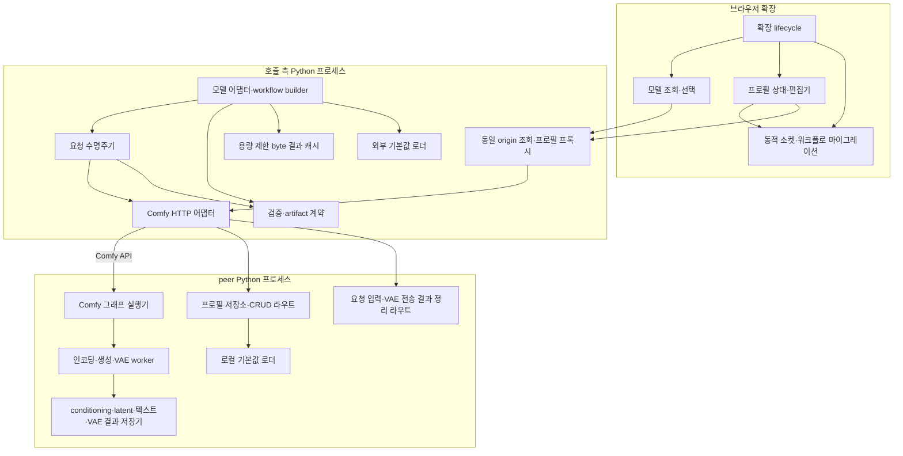

# C3 · 컴포넌트

| 컴포넌트 | 소유 코드 |
| --- | --- |
| 확장 lifecycle | `web/remote_conditioning.js`, `web/remote_qwen_image21.js` |
| 조회·모델 선택 | `web/remote_choices.js` |
| 프로필 상태·편집기 | `web/remote_profiles.js`, `web/remote_profile_dialog.js` |
| 그래프 소켓·마이그레이션 | `web/remote_sockets.js` |
| MiniMax 미디어·workflow | `remoteworker/minimax/media.py`, `remoteworker/minimax/reference_workflow.py` |
| 노드·라우트 조립 | `remoteworker/registry.py` |
| 요청 수명주기·HTTP | `remoteworker/core/execution.py`, `remoteworker/core/transport.py` |
| 공유 검증·미디어·artifact | `remoteworker/core/protocol.py`, `remoteworker/core/media.py`, `remoteworker/core/artifacts.py` |
| 캐시 | `remoteworker/core/result_cache.py` |
| 조회·정리 라우트 | `remoteworker/integration/discovery_routes.py` |
| 프로필 저장·프록시 | `remoteworker/prompt/profiles.py`, `remoteworker/prompt/transport.py`, `remoteworker/integration/profile_routes.py` |
| artifact IO | `remoteworker/integration/artifact_io.py` |
| 원격 VAE·웜업 | `remoteworker/vae/service.py`, `worker.py`, `warmup.py`, `codec.py` |
| VAE 전송 결과 정리 | `remoteworker/vae/routes.py` |

## 자동 준비

- [입력 해석·큐 스케줄링·일회 handoff·웜업 코드](05-preparation.md)
- 실측 admission·VAE 준비 보호·요청별 취소·일회 전달

- Qwen 모델 선택: peer 파일명 기준 경로 해석·누락 선택 보존 · [C4 계약](04-code.md#qwen-원격-모델-선택)
