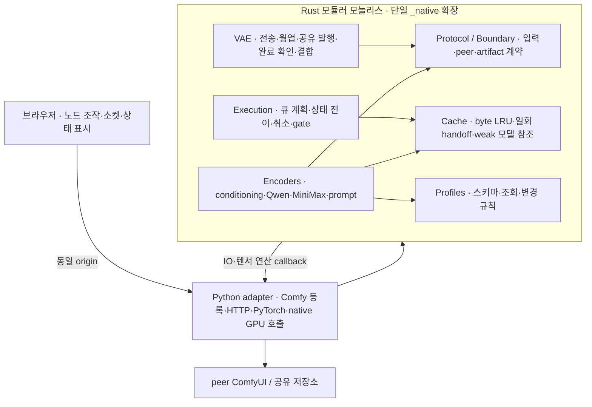

# C3 · RemoteWorker 컴포넌트

## 실행·실패 계약

- 호출 측·peer 각각의 ComfyUI 프로세스 내부 native 모듈 로드 · 별도 Rust 서버 없음
- 검증된 ID·정책·미디어 종류·슬롯 단계의 Rust 타입 소유 · 외부 입력의 런타임 검증 후 구성
- Python 예외의 FFI 전달 · 실패 시 해당 prompt 취소 · 업로드 성공분의 요청별 정리
- 공유 파일: no-follow dirfd·고정 writer FD → 파일 fsync → rename → 상위 디렉터리 fsync → receipt 검증 → 입력 삭제
- native 바이너리 필수 · Python 핵심 로직 대체 구현 없음

- 프로세스 종료: 신규 입장 차단·진행 작업 취소·대기 wake·host/준비 worker join · Torch/CPython 최종화 이전 native frame 반환

## 도메인 계약

- [준비·메모리](../contracts/preparation.md)
- [파이프라인·원래 작업 미리보기](../contracts/pipeline.md)
- [공유 latent·영상·텐서](../contracts/shared-video.md)
- [파일 결합·최종화](../contracts/file-finalization.md)
- [노드 경험](../contracts/node-experience.md)
- [C4 코드 라우팅](04-code.md)
