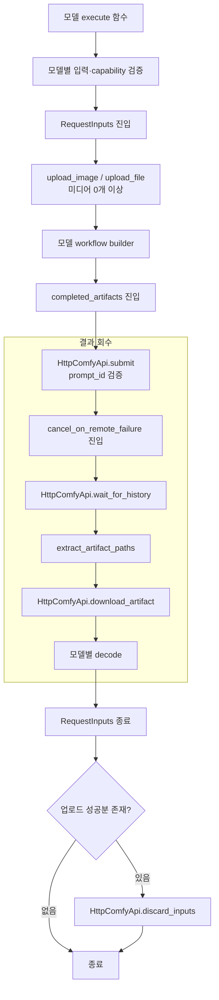
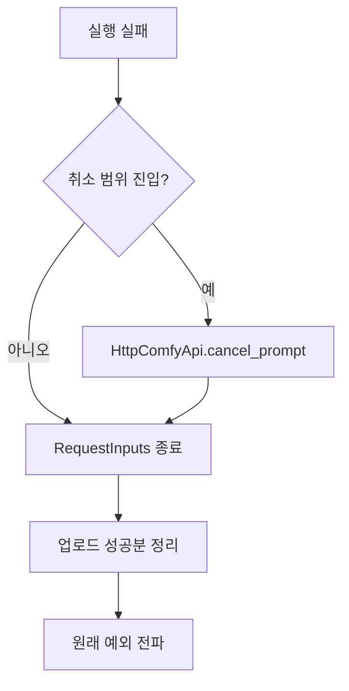
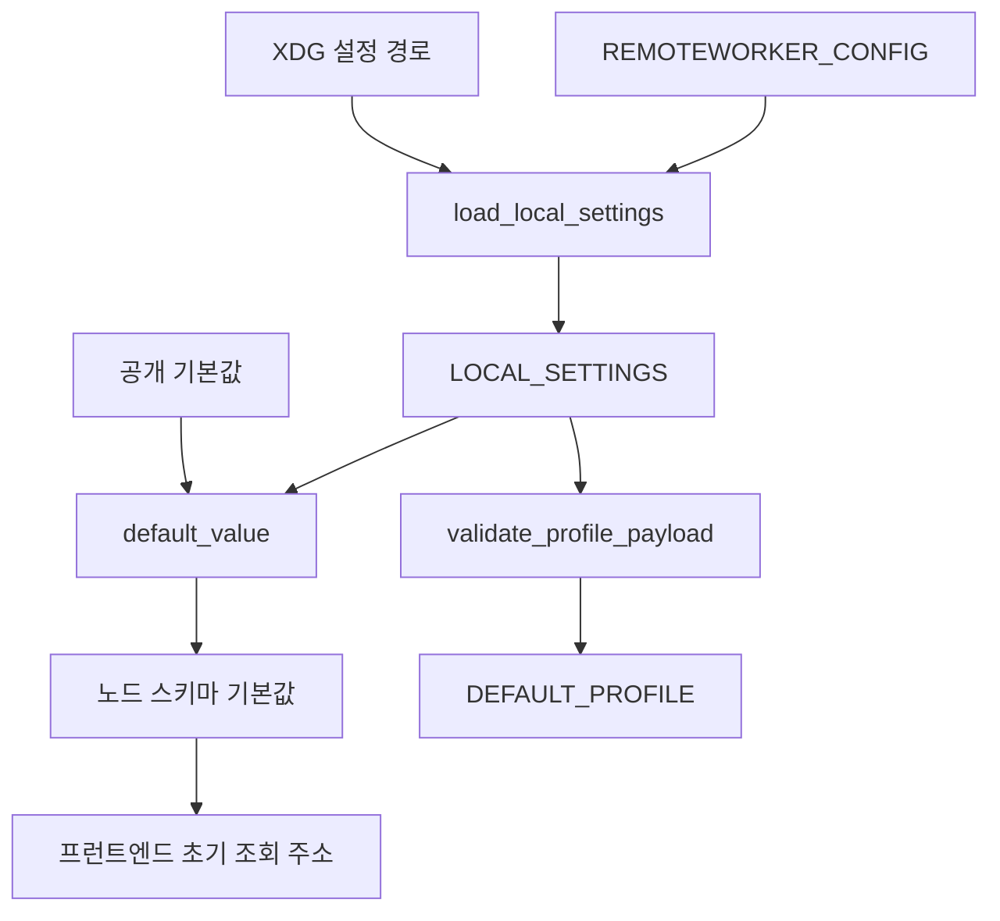

# C4 · 코드

## 미디어 요청 수명주기

### 실패 경로

| 계약 | 구조·불변 조건 |
| --- | --- |
| `ClipSelection` | `clip_name`, `clip_type`, `device` |
| `RemoteArtifactSpec` | `name`, `output_node`, `ui_field`, `extension`; 요청 경로·확장자 검증, spec별 결과 1개 |
| `RequestInputs` | 업로드 성공 후 정리; 해당 요청 입력만 삭제 |
| `completed_artifacts` | 유효 prompt ID·선언한 artifact; decode까지 취소 범위 유지 |
| `cancel_on_remote_failure` | 제출한 prompt만 취소; 원래 예외 보존 |
| `ByteResultCache` | 항목 수·byte 용량 제한; 직렬화 결과 |
| `PromptEnhancerProfileStore` | 검증한 레코드; 원자적 JSON 교체 |

## 기본값 해석

우선순위: 명시한 설정 경로 → XDG 기본 설정 경로 → 공개 기본값. 빈 `REMOTEWORKER_CONFIG`: 로컬 설정 비활성화. 저장한 워크플로 위젯값: 스키마 기본값과 별도 보존.

## 프런트엔드 경계

| 소유 함수·스키마 | 계약 |
| --- | --- |
| `addCustomNodeDefs` → `beforeRegisterVueAppNodeDefs` | Vue 등록 전 프로필 선택지 반영; 조회 주소는 백엔드 스키마 |
| `refreshRemoteChoiceOptions` | 응답 본문 해석 후 서버 주소 재확인; 잘못된 응답에서 기존 선택값 보존 |
| `syncPromptMediaInputs` | 이미지→영상 순서·연결 slot 보존; 미확인·다른 peer 정책에서 저장한 연결 유지 |
| `normalizeMiniMaxVaeInputs` | 저장된 VAE override 소켓·링크 마이그레이션 |
| `RemoteQwenImage21Node.define_schema` | V3 Autogrow의 `image_1`~`image_16`; ComfyUI 소켓 생명주기 |
