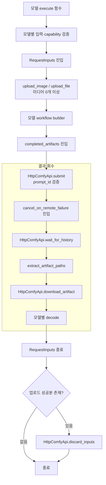
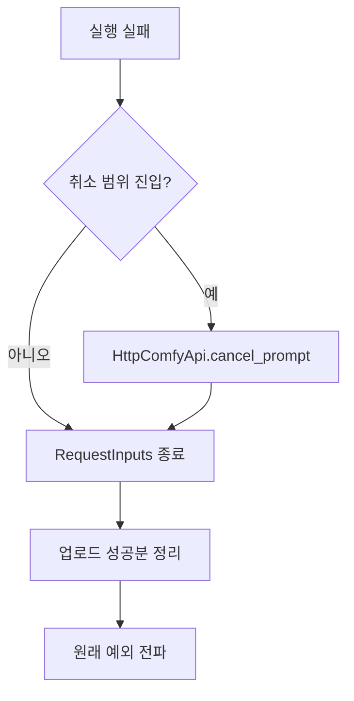
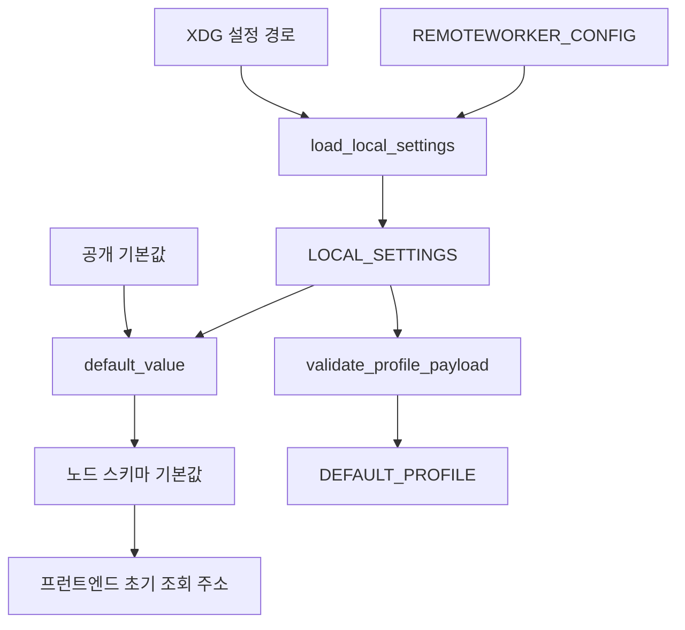
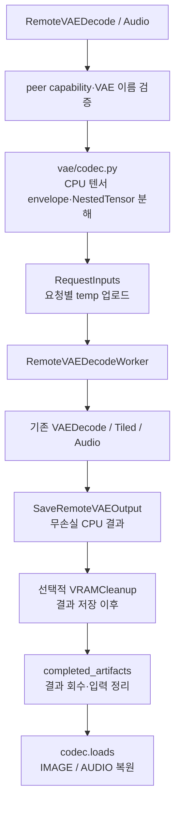

# C4 · 코드

## 미디어 요청 수명주기

### 실패 경로

| 계약 | 구조·불변 조건 |
| --- | --- |
| `ClipSelection` | `clip_name`, `clip_type`, `device` |
| `RemoteArtifactSpec` | `name`, `output_node`, `ui_field`, `extension`; 요청 경로·확장자 검증, spec별 결과 1개 |
| `RequestInputs` | 업로드 성공 후 정리; 해당 요청 입력만 삭제 |
| `completed_artifacts` | 유효 prompt ID·선언한 artifact; decode까지 취소 범위 유지 |
| `cancel_on_remote_failure` | 제출한 prompt만 취소; 원래 예외 보존 |
| `ByteResultCache` | 항목 수·byte 용량 제한; 직렬화 결과 |
| `PromptEnhancerProfileStore` | 검증한 레코드; 원자적 JSON 교체 |

## 기본값 해석

우선순위: 명시한 설정 경로 → XDG 기본 설정 경로 → 공개 기본값. 빈 `REMOTEWORKER_CONFIG`: 로컬 설정 비활성화. 저장한 워크플로 위젯값: 스키마 기본값과 별도 보존.

## 프런트엔드 경계

| 소유 함수·스키마 | 계약 |
| --- | --- |
| `addCustomNodeDefs` → `beforeRegisterVueAppNodeDefs` | Vue 등록 전 프로필 선택지 반영; 조회 주소는 백엔드 스키마 |
| `refreshRemoteChoiceOptions` | 응답 본문 해석 후 서버 주소 재확인; 잘못된 응답에서 기존 선택값 보존 |
| `syncPromptMediaInputs` | 이미지→영상 순서·연결 slot 보존; 미확인·다른 peer 정책에서 저장한 연결 유지 |
| `normalizeMiniMaxVaeInputs` | 저장된 VAE override 소켓·링크 마이그레이션 |
| `RemoteQwenImage21Node.define_schema` | V3 Autogrow의 `image_1`~`image_16`; ComfyUI 소켓 생명주기 |

## MiniMax 결과 저장

MiniMax Image to Video와 Reference는 `SaveRemoteConditioning`의 `conditioning` UI 필드에서 요청별 `.cond` 파일을 회수한다. ComfyUI 내장 `SaveConditioning`은 safetensors를 저장하고 해당 UI locator를 반환하지 않으므로 원격 반환 프로토콜에 사용하지 않는다. 기존 일반 conditioning 계약과는 별도 `REMOTE_CONDITIONING_ARTIFACT`로 선언한다.

## 원격 VAE·더미 웜업 · 개발 브랜치

| 소유 | 책임 |
| --- | --- |
| `vae/service.py` | 호출 노드·peer 사전 검사·워크플로 조립 |
| `vae/worker.py` | 요청 latent 로딩·네이티브 디코더 호출·더미 연산 |
| `vae/warmup.py` | 비동기 제출·ticket 검증·선택적 완료 대기 |
| `vae/routes.py` | 소비 완료 decoded tensor만 요청별 제거, symlink·경로 탈출 거부 |
| `vae/codec.py` | CPU 이동·무손실 직렬화·크기 제한·H3 결합 latent 복원 |
| 기존 `core/execution.py` | 제출·대기·실패 취소·임시 입력 정리 |

- `RemoteVAEWarmup`: 최소 zero latent 디코딩, 픽셀·파형 결과 즉시 폐기, 작은 완료 receipt만 저장
- `after` 입력 → `passthrough` 출력 → sampler conditioning: 인코딩·cleanup 뒤 웜업 제출, 샘플링과 peer 더미 연산 중첩
- `background=true`: 완료 ticket 즉시 반환, 실제 디코딩 직전 해당 prompt 완료·receipt 확인
- `warmup` 출력 → 원격 디코딩의 `warmup` 입력: 선행 완료 연결
- 웜업 경로 cleanup 없음, 실제 결과 저장 후 `release_after_result` 적용
- 모델 유지: ComfyUI 캐시·VRAM 정책에 따른 best effort; 외부 cleanup·다른 작업의 모델 교체 가능
- cleanup capability: 기본 두 옵션 지원, `reset_execution_cache` 확장 없는 설치본 허용
- 결과 회수 후 요청별 `decoded_*.pt` 자동 제거, 정리 실패 경고
- 전송: 요청당 512 MiB 제한, 긴 영상의 chunk 전송 미구현, 손실 압축 없음
- 동일 로컬 인터페이스·포트로의 원격 호출 거부: 직렬 큐 자기 대기 방지
- 다음 작업 자동 선처리·디코딩 우선 스케줄러: 미연결, 현재 명시적 그래프 순서만 지원
- 검증: `tests/test_remote_vae.py`, 격리 caller/peer 간 `tools/smoke_vae.py`

## VAE 노드 조작·연결 계약

| 소유 | 계약 |
| --- | --- |
| `vae/schema.py` | 입력·고급 설정 메타데이터·`REMOTE_VAE_WARMUP` 전용 타입 SSoT |
| `web/vae_definitions.js` | 노드 등록 전 원격 목록 준비, 캔버스·Vue 고급 위젯 메타데이터 적용 |
| `web/remote_vae.js` | 모델 검색·선택 보존·짧은 실패 상태·명시적 고급 설정 전환 |
| `locales/ko/nodeDefs.json` | 노드·입출력 이름·도움말 한국어 표시 |

- 재조회·서버 변경: 기존 VAE 선택 보존, 임의 모델 교체 없음
- 버튼: 고정 식별자와 표시 label 분리, 실행 값 직렬화 제외
- 준비 신호: 다른 데이터 소켓 연결 차단, 기존 STRING 링크 로딩 시 타입 정규화
- 동기·비동기 웜업 모두 서버·모델·대상 정보를 담은 ticket 반환
- worker: `DEV_ONLY`, 노드 검색 기본 숨김·peer 실행 유지
- 회귀: `tests/test_vae_ui.py`, 기존 실행·실패·취소 계약 테스트

## 자동 원격 준비

- [C3 흐름·C4 코드 책임·실측 스케줄 정책](05-preparation.md)
- 상태: `GET /remoteworker/preparation` · ComfyUI 자동 준비 패널
- 실행 판별: native progress · 브라우저 client ID와 독립
- 범위: 다음 선두 1개·허용 CPU 조상·작업별 일회 전달

## Qwen 원격 모델 선택

- `core.protocol.resolve_peer_model_name`: 완전 일치 우선 · `/`·`\` 구분자만 동등 처리 · 유일 후보의 peer 원본 이름 반환
- 누락·모호한 후보: 업로드·큐 제출 전 실패 · 대소문자·디렉터리·파일명 보존
- `qwen.service._validate_peer_loaders`: CLIP·VAE 이름 해석 → `execute`의 workflow builder 전달
- `web/remote_choices.js::resolvePeerModelChoice`: 동일 경로 선택 복구 · 누락·모호한 기존 선택 보존 · 빈 선택만 첫 항목 초기화
- `web/remote_qwen_image21.js`: peer 목록 갱신·파일명 선택 · `remote_text_encoder` COMBO 입력과 로컬 `CLIP` 출력의 연결 불가
