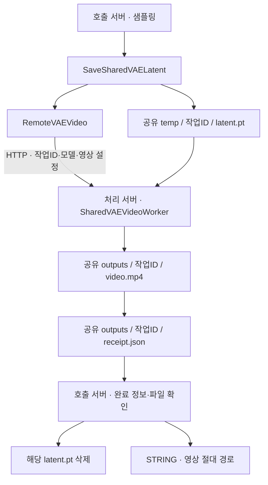
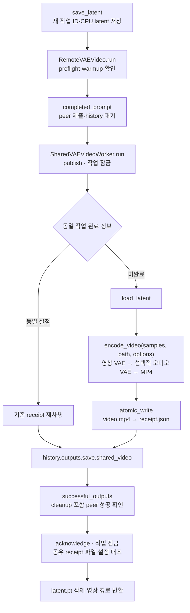

# 공유 VAE 영상 저장 · C2~C4

## C2 · 실행·저장 구조

| 항목 | 계약 |
| --- | --- |
| 공유 root | `REMOTEWORKER_SHARED_VAE_DIR` → `CLUSTER_ROOT/shared/remote-vae`; 양쪽 서버의 동일 절대 경로·공유 파일 |
| GenRel 경로 주입 | `genrel/environments.py` → `<GenRel>/shared/remote-vae` |
| HTTP 요청·응답 | 작업 ID·VAE 이름·FPS·CRF·타일 설정 → `shared_video` 완료 정보 |
| 영상 형식 | MP4·H.264·sRGB 8비트·기본 CRF 18·기본 24 FPS |
| 오디오 선택 | `audio_vae_name` 지정: H3 결합 latent 디코딩; 미지정: 저장된 `remote_vae_audio` |

## C3 · 코드 소유

| 소유 코드 | 진입점·책임 |
| --- | --- |
| `vae/shared_video.py` | `SaveSharedVAELatent`, `LoadSharedVAELatent`, `RemoteVAEVideo` · 공개 노드·peer workflow·결과 확인 |
| `vae/shared_store.py` | `save_latent`, `load_latent`, `publish`, `acknowledge` · 공유 파일·작업 잠금·완료 상태 |
| `vae/worker.py` | `SharedVAEVideoWorker`, `encode_video` · 네이티브 VAE·영상 인코딩 |
| `vae/schema.py` | `video_fields`, `video_options`, `decode_fields`, `DECODE_DEFAULTS` · caller/worker 설정 정본 |
| `vae/codec.py` | `cpu_value`, `restore` · CPU 텐서·메타데이터·NestedTensor 직렬화 |
| `core/execution.py` | `completed_prompt` · 제출·대기·결과 소비 중 대상 취소 |
| `core/artifacts.py` | `successful_outputs` · peer 성공 상태·오류 해석 |
| `preparation/plan.py`, `integration.py` | `RemoteVAEVideo` 디코더 등록·VAE 준비·`latent` 선실행 제외 |

## C4 · 발행·완료 확인

| 계약 | 동작 |
| --- | --- |
| 저장 노드 출력 | `REMOTE_VAE_LATENT` 작업 ID·재시도용 `STRING` 작업 ID |
| 읽기 노드 출력 | 보존된 작업 ID·복원된 `LATENT` |
| 인코더 연결 | `publish(request_id, options, encode)` → `worker.encode_video` 또는 테스트 인코더 |
| 발행 순서 | MP4 임시 쓰기·fsync·rename → receipt 임시 쓰기·fsync·rename |
| receipt 필드 | `request_id`, `path`, `bytes`, `options`, `frames`, `width`, `height`, `audio` |
| 입력 삭제 조건 | peer 성공·응답 receipt와 공유 receipt 일치·예상 경로·양수 파일 크기·설정 일치 |
| 메모리 해제 | `release_after_result`: 영상·receipt 저장 → `VRAMCleanup` → 호출 측 ack |
| 재시도 | `RemoteVAEVideo.request_id`; 동일 ID·동일 설정의 완료 결과 재사용 |
| 설정 변경 | 완료된 동일 ID의 다른 설정 거부; 보존 latent 읽기 → 새 저장 ID |
| 실패·취소 | latent 보존·제출한 peer prompt만 취소 |
| 경로 검증 | 32자리 소문자 hex 작업 ID·요청 경로의 symlink 거부 |
| 보존 범위 | 최종 MP4·receipt·실패 latent·`request.lock`; 자동 만료 없음 |
| 잠금 범위 | 작업별 `publish`·`acknowledge`; 대기 재시도와의 inode 경합 방지를 위한 lock 파일 유지 |

## 검증 진입점

| 파일·모드 | 검증 범위 |
| --- | --- |
| `tests/test_shared_vae_video.py` | 실제 caller/worker/store·인코더 대체·실패 보존·완료 재사용·경로·설정 검증 |
| `tests/test_remote_vae.py` | 텐서 반환·웜업·요청 취소·정리 |
| `tests/test_vae_ui.py` | 입력·한국어 표시·모델 선택·준비 신호 |
| `tools/e2e_vae.py --mode shared --large` | zero H3 latent·512×512·175프레임·525 MiB·오디오·재조회·실패 복구·입력 삭제 |
| `tools/e2e_vae.py --mode tensor --kind audio` | 네이티브 AUDIO와 원격 반환의 bit-exact 비교 |
