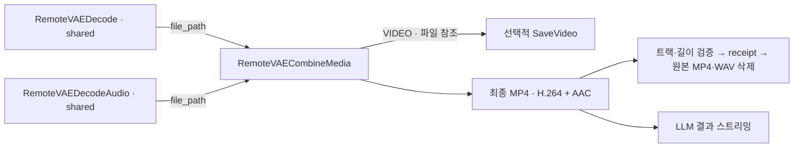

# 공유 영상·음성 최종화 · C3~C4

| 소유 | 책임 |
| --- | --- |
| `vae/mux.py` | 공유 root·receipt 검증, 정렬된 작업 잠금, 결정적 최종 ID, subprocess 취소, 영상 streamcopy·음성 AAC·faststart, 원자 발행, 성공 후 소비 파일 정리 |
| `vae/combine_node.py` | STRING 경로 입력, 기존 VIDEO 출력, 공유된 graph 분기의 입력 파일 보존, 최종 `shared_media`·소비 source ID 반환 |
| `web/shared_combine.js` | 기존 CreateVideo 연결의 명시적 파일 경로 전환·완료 영상 플레이어 |
| LLM `generation/preview.py` | 최종 shared receipt 우선·소비된 source 결과 제외 |

- 텐서 모드: 기존 IMAGE/AUDIO → CreateVideo
- shared 모드: STRING `file_path` → RemoteVAECombineMedia · 텐서 출력 ExecutionBlocker 유지
- final output: `outputs/<sha256(source IDs)[:32]>/video.mp4`·`receipt.json`
- 입력: 공유 root의 검증된 `video.mp4`·선택적 `audio.wav` · 임의 파일 경로·외부 URL 제외
- 영상·음성 길이 차이 250ms 초과: 결합 거부·입력 보존
- 영상 무재인코딩·WAV→AAC 192kbps · 짧은 음성 무음 보완·영상 길이 유지
- 발행: 임시 파일 → 트랙·양수 길이·영상 길이 비교 → atomic replace → receipt → 중간 파일 소비
- 실패·취소: 임시 파일 제거·source 유지 · receipt 발행 뒤 정리 중단: 같은 source ID 재시도로 정리 재개
- 소비 후 source decoder 재시도: consumed marker·최종 receipt 검증 후 기존 경로 참조 재사용 · finalizer 재시도: 기존 최종 receipt 재사용
- `cleanup_sources=false` 또는 다른 graph 분기의 동일 path 입력: source 보존
- 최종화 후 유지: 최종 MP4·receipt·source별 작은 receipt/consumed marker·0바이트 잠금 파일
- LLM의 완료 기준: 네이티브 ComfyUI 전체 prompt 종료 · finalizer 실패를 완료로 처리하지 않음
