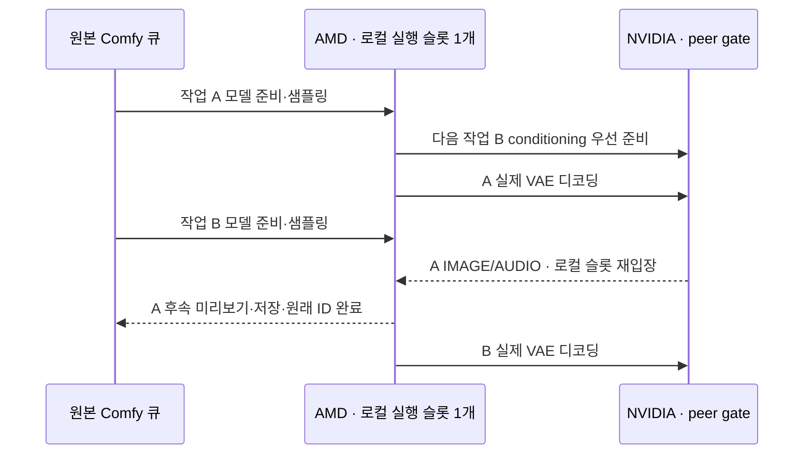

# AMD 로컬 실행·원격 디코딩 파이프라인

## C2 · 실행 구조

- 활성 조건: `CLUSTER_RUNTIME=amd`·`REMOTEWORKER_PIPELINE != 0`·호환되는 Comfy 실행 상태 계약
- 같은 프로세스의 native PromptExecutor 2개 · 로컬 GPU 실행 슬롯 1개 · 원격 I/O 구간만 슬롯 반환
- 큐 정본·prompt ID·history·민감 extra data 필터: native PromptQueue 유지
- 다음 큐 인출: 로컬 슬롯 확보 후 · 최대 실행 작업 2개 · 원격 결과 준비 완료 작업의 재입장 우선
- MemAvailable 2 GiB 미만: 다음 작업 인출 보류 · 현재 원격 작업 완료 경로 유지
- GPU 모델·LoRA 준비의 별도 GPU 병렬 실행 제외 · 기존 준비를 원격 디코딩 시간과 중첩

## C3 · 책임

| 코드 | 소유 책임 |
| --- | --- |
| `pipeline/__init__.py` | GenRel AMD 활성 조건·native host 계약 검사·worker 설치 |
| `pipeline/slots.py` | 로컬 소유권·원격 대기 중 반환·결과 준비 후 재입장·최대 2개 작업 상태 |
| `pipeline/host.py` | native executor/cache 구성·큐 완료 이력·실행 상태 저장/복원·취소·유휴 정리 |
| `pipeline/reuse.py` | native 입력 signature 기반 MODEL 출력의 약한 참조 재사용·16개 키 상한 |
| `preparation/integration.py` | 준비된 conditioning의 peer gate 없는 소비·실제 decoder에서 슬롯 반환 |
| `preparation/coordinator.py` | 현재 로컬 작업 우선 관측·다음 CLIP lookahead·파이프라인 중 dummy 웜업 제외 |
| `web/scheduler_view.js`·`preparation.js` | 로컬/원격/결과 준비 완료 단계·원래 작업 ID·메모리 보류 표시 |

## C4 · 실행 상태 계약

- 슬롯 반환 이전: 다음 선두 작업 캡처·MODEL 재사용 정보 발행·native model tracker의 현재 사용 예약 해제
- 보존 상태: client ID·현재 node/prompt ID·workflow metadata·progress registry·RAM cache callback/headroom·미리보기 방식·GraphBuilder prefix·model tracker 참조
- 원격 대기: 캡처한 다음 선두의 CLIP 우선 준비 후 실제 VAE·해당 작업의 취소 Event만 관측 · 다른 로컬 작업의 전역 interrupt 소비 제외
- 재입장: 상태 복원·model tracker 사용 예약 복구·해당 작업의 interrupt 복원 → 원래 decoder 결과·후속 노드 계속 실행
- peer gate 반환: 로컬 슬롯 재입장 이전 · peer 대기와 로컬 슬롯 사이의 순환 대기 방지
- 선계산 전환: native `is_changed` 메타데이터 제외·입력 계약 snapshot 비교 · 선두의 실행 중 전환으로 정상 선계산 취소 금지
- 준비된 conditioning: peer gate 대기 중에도 일회 결과 소비 · 이전 실제 VAE를 기다리는 중복 인코딩 방지
- 동일 모델 재사용: native CacheProvider·입력 signature·MODEL 출력 계약 · 두 executor 사이의 모델/LoRA 중복 로딩 억제
- 재사용 키: native class type·전체 조상/입력 signature hash · LoRA 이름·강도 등 입력 변경의 native invalidation 유지
- 재사용 참조: weak reference·native cache에서 해제된 모델의 추가 보존 없음 · `/free` 시 provider 키와 양쪽 cache 정리
- native cache provider의 지연 on_store: 원격 대기 직전 native cache에서 약한 참조 발행 · 동기 노드의 event loop 대기 이전 재사용 가능
- 모델 첫 준비·다른 모델/LoRA·메모리 퇴거: 초기화 비용 잔존
- `/interrupt`·`/api/jobs/{id}/cancel`: 원격 대기 작업의 Event 또는 현재 로컬 작업의 native interrupt 선택 · 타 작업 전파 제외
- 완료: 실제 후속 노드 실행 뒤에만 native `task_done`·history 성공/실패 · 전경 완료 event의 원래 prompt/client ID 유지
- 모델 unload·`/free`·GC·asset scan 재개: 모든 파이프라인 작업 종료 후 로컬 슬롯 안에서 수행
- 호환 계약 미충족: 기존 worker 유지 · `REMOTEWORKER_PIPELINE=0`으로 기존 실행 경로 선택 가능

## 상태·검증 경계

- `/remoteworker/preparation.pipeline`: `enabled`·`capacity`·`local_prompt_id`·작업별 `local/remote/ready`·`admission`·`model_reuse_hits`
- `tests/test_pipeline_slots.py`: 원격 대기 중 다음 샘플링·예외 후 로컬 소유권 복구·weak MODEL 재사용·설정 변경·UI 단계
- `tests/fixtures/pipeline_nodes`: CPU 전용 native 통합 fixture · `REMOTEWORKER_PIPELINE_FIXTURE=1` 명시 필요 · 운영 등록 제외
- `tools/e2e_pipeline.py`: fixture 서버의 원본 큐·미리보기 ID·처리 중첩·MODEL 재사용·설정 변경·대기 작업 개별 취소
- fixture 서버: 별도 base directory의 `custom_nodes/pipeline_nodes`에 fixture 연결·`RemoteWorker` 연결 · `CLUSTER_RUNTIME=amd`·`--cpu`·두 노드 디렉터리 whitelist
