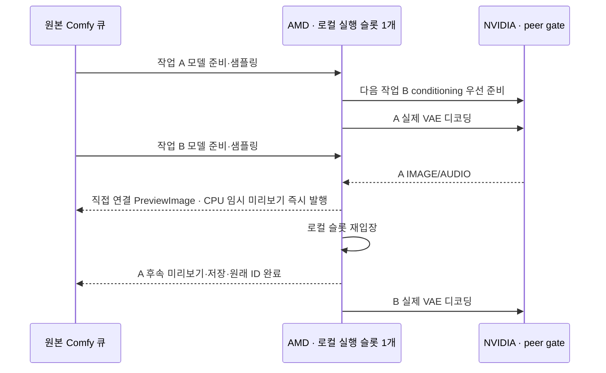

# AMD 로컬 실행·원격 디코딩 파이프라인

## C2 · 실행 구조

- 활성 조건: `CLUSTER_RUNTIME=amd`·`REMOTEWORKER_PIPELINE != 0`·호환되는 Comfy 실행 상태 계약
- 같은 프로세스의 native PromptExecutor 2개 · 로컬 GPU 실행 슬롯 1개 · 원격 I/O·직접 연결 CPU 미리보기 구간의 슬롯 반환
- 큐 정본·prompt ID·history·민감 extra data 필터: native PromptQueue 유지
- 다음 큐 인출: 로컬 슬롯 확보 후 · 최대 실행 작업 2개 · 원격 결과 준비 완료 작업의 재입장 우선
- MemAvailable 2 GiB 미만: 다음 작업 인출 보류 · 현재 원격 작업 완료 경로 유지
- GPU 모델·LoRA 준비의 별도 GPU 병렬 실행 제외 · 기존 준비를 원격 디코딩 시간과 중첩

## C3 · 책임

| 코드 | 소유 책임 |
| --- | --- |
| `rust/src/execution.rs` | typed 슬롯 단계·최대 2개 작업·peer gate·weak MODEL 재사용 |
| `rust/src/execution/host.rs` | 큐 입장·executor/cache 구성·완료 이력·취소·유휴 정리·원격 완료 순서 |
| `rust/src/execution/previews.rs` | 직접 PreviewImage 판정·원래 prompt/client 이벤트·UI 재사용 |
| `rust/src/execution/integration.rs`·`coordinator.rs` | managed handoff·현재 작업 관측·다음 CLIP·dummy 웜업 제외 |
| `remoteworker/pipeline/__init__.py` | Comfy host 계약 검사·worker 설치 |
| `remoteworker/pipeline/host.py` | native state 캡처·복원·GPU API·thread·middleware adapter |
| `remoteworker/pipeline/slots.py` | Python lock·thread-local·context manager adapter |
| `web/scheduler_view.js`·`preparation.js` | 단계·작업 ID·메모리 보류 표시 |

## 실행 상태 계약

- 슬롯 반환 이전: 다음 선두 작업 캡처·MODEL 재사용 정보 발행·native model tracker의 현재 사용 예약 해제
- 보존 상태: client ID·현재 node/prompt ID·workflow metadata·progress registry·RAM cache callback/headroom·미리보기 방식·GraphBuilder prefix·model tracker 참조
- 원격 대기: 캡처한 다음 선두의 CLIP 우선 준비 후 실제 VAE·해당 작업의 취소 Event만 관측 · 다른 로컬 작업의 전역 interrupt 소비 제외
- 재입장: Ready→Restoring에서 ready 예약 해제 → 상태·model tracker·해당 작업 interrupt 복원 → Local · 복원 실패 시 Failed·작업 정리·후속 입장 허용
- peer gate 반환: 로컬 슬롯 재입장 이전 · peer 대기와 로컬 슬롯 사이의 순환 대기 방지
- 선계산 전환: native `is_changed` 메타데이터 제외·입력 계약 snapshot 비교 · 선두의 실행 중 전환으로 정상 선계산 취소 금지
- 준비된 conditioning: peer gate 대기 중에도 일회 결과 소비 · 이전 실제 VAE를 기다리는 중복 인코딩 방지
- 동일 모델 재사용: native CacheProvider·입력 signature·MODEL 출력 계약 · 두 executor 사이의 모델/LoRA 중복 로딩 억제
- 재사용 키: native class type·전체 조상/입력 signature hash · LoRA 이름·강도 등 입력 변경의 native invalidation 유지
- 재사용 참조: weak reference·native cache에서 해제된 모델의 추가 보존 없음 · `/free` 시 provider 키와 양쪽 cache 정리
- native cache provider의 지연 on_store: 원격 대기 직전 native cache에서 약한 참조 발행 · 동기 노드의 event loop 대기 이전 재사용 가능
- 모델 첫 준비·다른 모델/LoRA·메모리 퇴거: 초기화 비용 잔존
- `/interrupt`·`/api/jobs/{id}/cancel`: 원격 대기 작업의 Event 또는 현재 로컬 작업의 native interrupt 선택 · 타 작업 전파 제외
- 조기 미리보기: decoder 출력 0의 CPU IMAGE → 직접 연결 native `PreviewImage` · 실행 출력의 조상 집합만 대상 · 원래 prompt/client/display node ID로 `executed` 발행 · client ID 없는 API 작업의 broadcast 제외
- 조기 미리보기 상태: GPU 슬롯·전역 progress/model tracker·최종 저장 변경 없음 · 작업별 UI만 보관 · native 노드 재실행 시 임시 파일 재인코딩 없이 UI 재사용
- 중간 변환·커스텀 미리보기·영상 조립·최종 저장: native 후속 실행 유지 · 미리보기 선발행으로 성공 history 조기 기록 금지
- 조기 미리보기 실패·취소: 선발행 생략·native 실행/취소 경로 유지
- 완료: 실제 후속 노드 실행 뒤에만 native `task_done`·history 성공/실패 · 전경 완료 event의 원래 prompt/client ID 유지
- 모델 unload·`/free`·GC·asset scan 재개: 모든 파이프라인 작업 종료 후 로컬 슬롯 안에서 수행
- 호환 계약 미충족: 기존 worker 유지 · `REMOTEWORKER_PIPELINE=0`으로 기존 실행 경로 선택 가능

## 상태·검증 경계

- `/remoteworker/preparation.pipeline`: `enabled`·`capacity`·`local_prompt_id`·작업별 `local/remote/ready`·`preview_nodes`·`admission`·`model_reuse_hits`
- `tests/test_pipeline_previews.py`: 다음 로컬 실행 중 CPU 미리보기·원래 client ID·단일 인코딩·부분 실행/취소/변환/최종 저장 경계
- `tests/test_pipeline_slots.py`: 원격 대기 중 다음 샘플링·예외 후 로컬 소유권 복구·weak MODEL 재사용·설정 변경·UI 단계
- `tests/fixtures/pipeline_nodes`: CPU 전용 native 통합 fixture · `REMOTEWORKER_PIPELINE_FIXTURE=1` 명시 필요 · 운영 등록 제외
- `tools/e2e_pipeline.py`: fixture 서버의 원본 큐·미리보기 ID·처리 중첩·MODEL 재사용·설정 변경·대기 작업 개별 취소
- fixture 서버: 별도 base directory의 `custom_nodes/pipeline_nodes`에 fixture 연결·`RemoteWorker` 연결 · `CLUSTER_RUNTIME=amd`·`--cpu`·두 노드 디렉터리 whitelist

- 프로세스 종료: 신규 입장 차단·진행 작업 취소·대기 wake·host/준비 worker join · Torch/CPython 최종화 이전 native frame 반환
