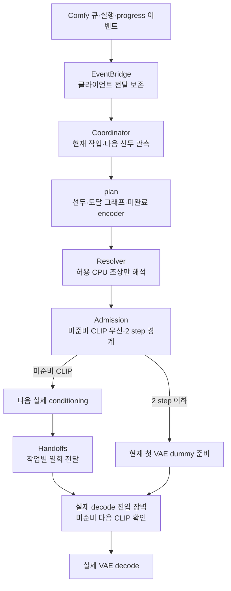
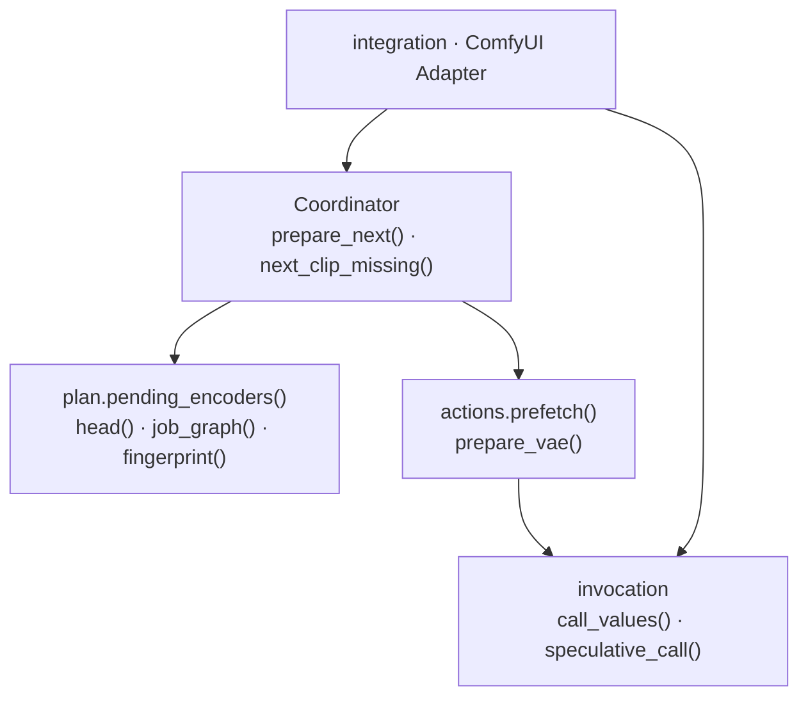

# 자동 준비 · CLIP 우선·2 step VAE 전환

## 실행 정책

- [AMD 파이프라인](pipeline.md) 활성 시: 다음 CLIP lookahead 유지·실제 VAE 디코딩으로 dummy 웜업 대체·원격 대기 중 다음 작업 실행
- 아래 2 step 웜업 정책: 파이프라인 비활성 host의 실행 경로

| 조건 | 처리 |
| --- | --- |
| 샘플링 3 step 이상 남음 | 다음 conditioning 처리 · VAE 웜업 보류 |
| 샘플링 2 step 이하 남음 | VAE 웜업 준비 |
| 다음 선두 작업의 conditioning 미준비 | 남은 step·VAE 준비 여부와 무관하게 CLIP 먼저 완료 |
| CLIP 중 샘플링 종료 | CLIP 유지 · 현재 VAE 디코딩의 gate 대기 |
| 다음 작업 삭제·선두 변경·입력 변경 | 해당 선계산 취소 · 새 선두 확인 |
| VAE dummy 웜업 중 새 CLIP 요청 | 해당 dummy 웜업 협력 취소 · CLIP 이후 VAE 재준비 |
| 이미 실행 중인 실제 VAE decode | 현재 GPU 연산 유지 · 즉시 선점 제외 |

- 권위 큐: ComfyUI 원본 큐 · 다음 선두 1개만 lookahead
- 판단 근거: native structured progress의 `total - step` · `Admission.vae_steps` 임계값 정본·상태 API/UI 공유
- 최근 CLIP·VAE 처리 시간: 관측용
- VAE 이미 준비된 경우: 새 CLIP 실행 시 준비 예약 무효화 · CLIP 후 재준비 또는 실제 decode로 로딩
- 디코딩 진입 장벽: 같은 peer의 미준비 다음 CLIP 우선 처리 · 전경 decode gate 입장 이전
- 삭제된 다음 작업: 현재 영상 실패로 전파 금지 · 취소·재정렬 뒤 선두 재확인
- `GenRelInput`: GenRel 공통 입력 · 문자열/숫자·CPU 이미지/마스크·영상/오디오 로더 · `Resolver.SAFE_TYPES` 허용 · GPU 모델 로딩 제외
- `RequestConditionInput`: GenRel Draft의 CPU 문자열 입력 · `Resolver.SAFE_TYPES` 허용 · name/text → STRING 계약
- 지원 외 입력·다음 encoder 실패·handoff 용량 초과: 상태 표시·일반 전경 재계산 경로 유지
- 수동 warmup 연결: 자동 웜업 선택보다 우선 · 실제 decode의 다음 CLIP 우선 장벽 유지

## 원격 노드의 준비 계약

- 정본: 등록 노드 클래스의 `REMOTE_PREPARATION: Preparation`
- `capabilities.discover`: 노드 등록 매핑 → 역할·실행 대상·입력 adapter 발견
- encoder: 다음 선두의 실제 입력 선계산 · decoder: 현재 작업 첫 원격 VAE의 고정 dummy 준비
- encoder 단독·decoder 단독·혼합 그래프의 동일 정책 경로
- `Preparation.executor`: 네이티브 노드와 분리된 실행 서비스 지정 · 미지정 시 등록 클래스
- `Preparation.inputs`: 저장 그래프 입력 → 실행 서비스 인자 · Qwen `images.image_N` → `image_N`
- 전경·사전 계산: 동일 실행 서비스의 `run` 경유 · 기본값 정규화·peer gate·일회 handoff 공유
- 작업 내 노드 식별: `UNIQUE_ID`·V3 `Hidden.unique_id` → 실행 서비스 `unique_id`
- 선언 없는 노드·미감사 GPU/LLM 조상: 자동 실행 제외 · 일반 전경 처리 유지

## C3 · 실행 협력

- 구동: 이벤트 wake·이벤트 합치기 · 5초 안전 재확인
- 취소 신호: 백그라운드 준비의 전경 interrupt 소비 금지 · gate 입장 대기 중 전경 취소 확인
- 별도 주기: 원격 요청 history polling · 상태 창 표시 중 2초 조회
- CPU 조상: 이미지 로딩·크기·스케일·해상도 선택·primitive·수식 허용 목록 · 모델/LLM 임의 실행 제외
- PeerGate: peer별 실행 직렬화 · 입장한 CLIP 완료 후 decode · 동일 요청 중복 선계산 방지
- 범위: 이 호출 서버의 다음 선두·동일 peer

## 웜업·실제 처리

| 구분 | 입력·수행 | 범위 |
| --- | --- | --- |
| VAE 웜업 | 실제 선택 모델 + 고정 zeros latent decode | 결과 폐기 |
| 다음 CLIP 준비 | 다음 작업의 실제 prompt·참조 이미지·해상도·길이 | 실제 conditioning |
| 실제 VAE | 현재 sampling latent decode | 영상 우선 · 오디오는 실제 decode 시 로딩 가능 |

- 고정 dummy: H3 영상 `(1,C,2,2,2)` / H3 오디오 `(1,32,2,8)` / 일반 이미지 `(1,C,8,8)`
- I2V 참조 이미지의 VAE 인코딩: CLIP 준비 단계의 필수 연산 · dummy 웜업 시점과 별도
- 8GB 범위: 영상·오디오 VAE 동시 상주 보장 없음
- Handoffs: prompt ID·node ID·resolved signature 일치 시 1회 소비 · `always_refresh` 작업 간 재사용 금지 유지
- RAM 상한: Handoffs 직렬화 256MiB · 초과 예상 텐서 직렬화 생략
- RAM 압력: MemAvailable 2GiB 미만·30초 간격 · 폐기 가능 재사용 cache·GC 정리
- 보존: 활성 텐서·대기 Handoffs · 취소/소비/큐 이탈 결과 해제

## 코드 책임

| 소스 | 소유 책임 |
| --- | --- |
| `rust/src/graph.rs` | 선두·도달 그래프·encoder 판정·fingerprint |
| `rust/src/preparation.rs` | CLIP 우선·2 step admission·진행·예약·관측 |
| `rust/src/execution.rs` | Preparation 역할·CPU 조상·gate·handoff·메모리 압력 |
| `rust/src/execution/coordinator.rs` | 준비 순서·decode 장벽·취소 후 재확인 |
| `rust/src/execution/actions.rs` | 사전 계산·VAE 무효화·dummy 웜업·취소 이벤트 |
| `rust/src/execution/integration.rs` | managed 호출·입력 제외·등록 정책 |
| `remoteworker/preparation/` | Comfy discovery·event/thread/context·서명 바인딩 adapter |
| `rust/src/request.rs`·`boundary.rs` | 대상 취소·입력 정리·외부 계약 |
| `remoteworker/core/transport.py` | HTTP·history polling adapter |
| `rust/src/vae/policy.rs`·`execution.rs` | warmup receipt·고정 dummy decode 순서 |
| `web/preparation.js`·`scheduler_view.js` | 기본 상태·상세 설명·이력 |

## 호출 의존성

- 실행 컨텍스트: ContextVar 토큰 복원 · 중첩 호출·예외 경계 보존
- 선두 계획: 백그라운드 준비·decode 장벽의 동일 후보 판정

## 검증 경계

- 회귀: `tests/test_preparation_contracts.py`·`test_scheduler_policy.py`·`test_scheduler_ui.py`·`test_preparation_inputs.py`·`test_preparation_capabilities.py`
- 실제 GPU: `tools/e2e_scheduler.py` · 2 step 경계·3초 후 추가·2 step에서 추가·취소·선두 변경
- 출력: MiniMax H3 연결 I2V · 96×96·3 frames·MP4 0.100초 ± 0.002초
- 전달: 다음 실행 전 준비 완료·1회 소비 · 종료 Handoffs 0
