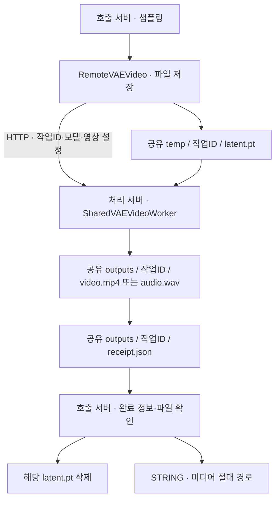
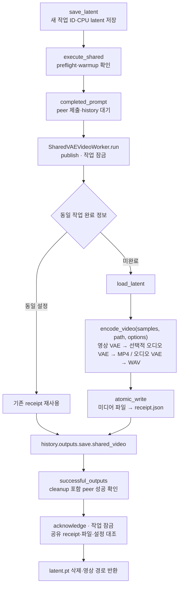

# 공유 VAE 텐서 전달·미디어 저장

## 통합 디코더 · 텐서 전달

| 경계 | 계약 |
| --- | --- |
| `RemoteVAEDecode`·`RemoteVAEDecodeAudio` | 원격 디코딩 → IMAGE/AUDIO 반환 · 최종 미디어 인코딩 없음 |
| `output_mode=tensor` | HTTP latent 업로드·디코딩 텐서 다운로드 · 512 MiB 전송 한도 |
| `output_mode=shared` | 공유 `temp/<ID>/latent.pt` → peer `decoded.pt`·`decoded-receipt.json` → 호출 측 CPU 텐서 읽기 |
| 공통 출력 | 0번 IMAGE/AUDIO 활성 · 기존 1번 STRING 소켓 호환 유지·비활성 |
| 미리보기·최종 저장 | 후속 노드 소유 · 이미지 배치·RGBA·오디오 파형·sample_rate 보존 |
| 전송 완료 | peer cleanup 포함 성공·receipt/설정/파일 크기 대조·텐서 형식 검증·취소 확인 → latent·decoded·receipt 삭제 |
| 전송 실패 | 입력·완료된 decoded 텐서 보존 · 오류의 작업 ID로 재시도 · 디코딩 완료 결과 재사용 |
| 경로·용량 | 공유 절대 root·작업별 잠금·원자 발행 · HTTP 직렬화 한도 제외·CPU RAM 사용 유지 |
| 고급 입력 호환 | 기존 FPS·CRF·오디오 VAE 입력 위치 유지·통합 디코더에서 숨김·실행에 미사용 |
| worker·caller | `vae/shared_tensor.py::SharedVAETensorWorker`·`execute`·`consume` |
| 공개 미디어 라우트 | 전달용 `.pt` 비노출 · 기존 최종 미디어 receipt만 조회 |

- `vae/delivery.py`: 양쪽 공유 root 접근 검사 정본
- `vae/shared_store.py`: 텐서 임시 receipt와 최종 미디어 receipt의 분리·공통 잠금·발행 검증
- `tests/test_shared_tensor.py`: 실제 worker·store·consumer·lossless 이미지 배치/오디오·재시도·실패 보존·성공 정리

## 명시적 파일 저장 노드

- 아래 MP4/WAV 발행 계약: `RemoteVAEVideo` 전용 · 통합 디코더의 전달 방식과 분리

## C2 · 실행·저장 구조

| 항목 | 계약 |
| --- | --- |
| 공유 root | `REMOTEWORKER_SHARED_VAE_DIR` → `CLUSTER_ROOT/shared/remote-vae`; 양쪽 서버의 동일 절대 경로·공유 파일 |
| GenRel 경로 주입 | `genrel/environments.py` → `<GenRel>/shared/remote-vae` |
| HTTP 요청·응답 | 작업 ID·VAE 이름·FPS·CRF·타일 설정 → `shared_video` 완료 정보 |
| 오디오 전용 형식 | 오디오 대상의 명시적 파일 저장: float32 PCM WAV · 네이티브 샘플레이트·1배치·모노/스테레오 |
| 영상 형식 | MP4·H.264·sRGB 8비트·기본 CRF 18·기본 24 FPS |
| 오디오 선택 | `audio_vae_name` 지정: H3 결합 latent 디코딩; 미지정: 저장된 `remote_vae_audio` |

## C3 · 코드 소유

| 소유 코드 | 진입점·책임 |
| --- | --- |
| `vae/delivery.py` | `check_shared`, `receive_probe` · 양방향 파일 접근 검사 |
| `vae/shared_video.py` | `execute_shared` · peer workflow·결과 확인; 기존 공유 노드 어댑터 공용 |
| `vae/shared_store.py` | `save_latent`, `load_latent`, `publish`, `acknowledge` · 공유 파일·작업 잠금·완료 상태 |
| `vae/worker.py` | `SharedVAEVideoWorker`, `encode_video` · 네이티브 VAE·영상 인코딩 |
| `vae/schema.py` | `video_fields`, `video_options`, `decode_fields`, `DECODE_DEFAULTS` · caller/worker 설정 정본 |
| `vae/codec.py` | `cpu_value`, `restore` · CPU 텐서·메타데이터·NestedTensor 직렬화 |
| `core/execution.py` | `completed_prompt` · 제출·대기·결과 소비 중 대상 취소 |
| `core/artifacts.py` | `successful_outputs` · peer 성공 상태·오류 해석 |
| `preparation/plan.py`, `integration.py` | `RemoteVAEVideo` 디코더 등록·VAE 준비·`latent` 선실행 제외 |

## 발행·완료 확인

| 계약 | 동작 |
| --- | --- |
| 저장 노드 출력 | `REMOTE_VAE_LATENT` 작업 ID·재시도용 `STRING` 작업 ID |
| 읽기 노드 출력 | 보존된 작업 ID·복원된 `LATENT` |
| 인코더 연결 | `publish(request_id, options, encode)` → `worker.encode_video` 또는 테스트 인코더 |
| 발행 순서 | MP4 임시 쓰기·fsync·rename → receipt 임시 쓰기·fsync·rename |
| receipt 필드 | 공통 `request_id`, `path`, `bytes`, `options`; 영상 `frames`, `width`, `height`, `audio`; WAV `sample_rate`, `samples` |
| 입력 삭제 조건 | peer 성공·응답 receipt와 공유 receipt 일치·예상 경로·양수 파일 크기·설정 일치 |
| 메모리 해제 | `release_after_result`: 영상·receipt 저장 → `VRAMCleanup` → 호출 측 ack |
| 재시도 | `RemoteVAEVideo.request_id`; 동일 ID·동일 설정의 완료 결과 재사용 |
| 설정 변경 | 완료된 동일 ID의 다른 설정 거부; 보존 latent 읽기 → 새 저장 ID |
| 실패·취소 | latent 보존·제출한 peer prompt만 취소 |
| 경로 검증 | 32자리 소문자 hex 작업 ID·요청 경로의 symlink 거부 |
| 보존 범위 | 최종 미디어·receipt·실패 latent·`request.lock`; 자동 만료 없음 |
| 잠금 범위 | 작업별 `publish`·`acknowledge`; 대기 재시도와의 inode 경합 방지를 위한 lock 파일 유지 |

## 통합 노드·브라우저 계약

- 신규 노드 기본 `shared` · 기존 저장 그래프·옵션 생략 API 기본값 호환
- `VALIDATE_INPUTS`: `SharedVAETensorWorker`·모델·공유 접근 검사 · 샘플러 실행 이전 실패
- `web/vae_delivery.js`: 전달 방식·공유 연결 상태·수신 완료 표시 · 자체 미디어 미리보기 제거
- `POST /remote-vae/preflight` → `POST /remote-vae/shared/check`
- `GET /remote-vae/media/{request_id}`: 명시적 파일 저장 결과의 검증된 경로·Range 응답

## 검증 진입점

| 파일·모드 | 검증 범위 |
| --- | --- |
| `tests/test_shared_vae_video.py` | 실제 caller/worker/store·인코더 대체·실패 보존·완료 재사용·경로·설정 검증 |
| `tests/test_remote_vae.py` | 텐서 반환·웜업·요청 취소·정리 |
| `tests/test_vae_ui.py` | 입력·한국어 표시·모델 선택·준비 신호 |
| `tools/e2e_vae.py --mode unified --kind image` | 통합 디코더의 공유 텐서 반환·네이티브 결과와 bit-exact 비교 |
| `tools/e2e_vae.py --mode unified --kind audio` | 통합 오디오 텐서 반환·네이티브 결과와 bit-exact 비교 |
| `tools/e2e_vae.py --mode shared --large` | zero H3 latent·512×512·175프레임·525 MiB·오디오·재조회·실패 복구·입력 삭제 |
| `tools/e2e_vae.py --mode tensor --kind audio` | 네이티브 AUDIO와 원격 반환의 bit-exact 비교 |
